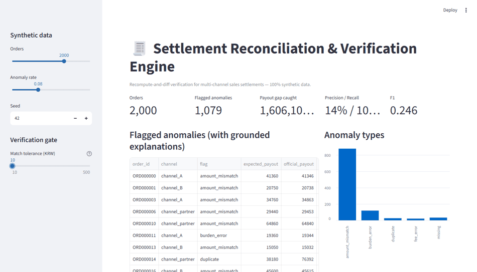
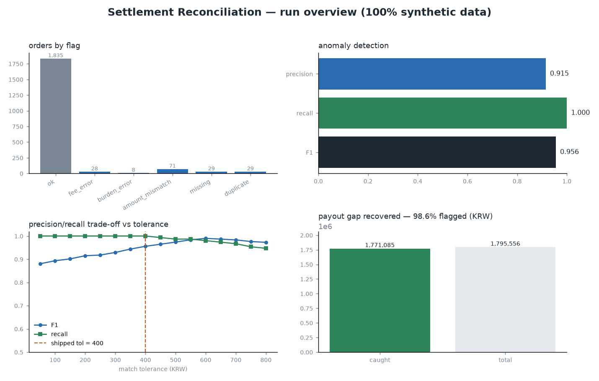
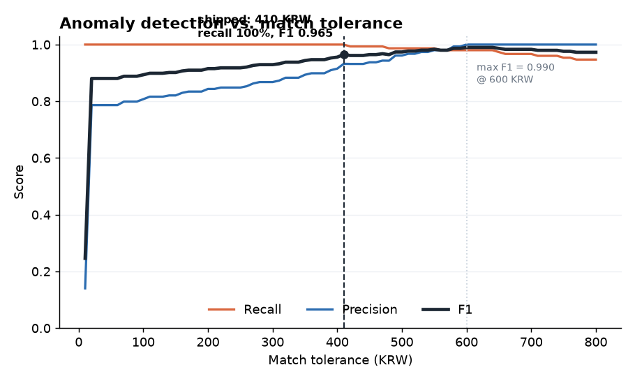

# Settlement Reconciliation & Verification Engine

[](https://github.com/cloudavenue0012-creator/settlement-reconciliation-engine/actions/workflows/ci.yml)


Recompute-and-diff verification for **multi-channel sales settlements**. The engine
never trusts the number a channel reports — it reconstructs the *expected* payout
for every order from first principles (order value + channel fee/discount rules),
diffs it against the channel's official settlement file, and flags the gaps:
wrong commission, mis-assigned discount burden, missing rows, double-counting,
and unexplained amount errors.

> **100% synthetic data.** Orders, stores, channel names, and fee rules are all
> randomly generated / illustrative (see `synth_data.py`, `rules.yaml`). No real
> company data, code, schemas, or figures are included. This repo is a portable
> re-implementation of a production pattern, built to be inspected.



*Slide the match tolerance and watch precision / recall trade off in real time.*
`streamlit run app.py`, or [deploy your own](#interactive-demo) on Streamlit Community Cloud.

## Why this exists

A merchant selling across delivery apps, partner platforms, and direct/POS
receives a settlement file from each channel and is expected to trust it. But
fees change, promo-funding splits are misapplied, and rows silently go missing or
get duplicated — each one a small, hard-to-notice cash leak. Manually spot-checking
thousands of orders doesn't scale. The fix is a **verification gate**: independently
recompute what each payout *should* be, and only trust matches within tolerance.

## Architecture

```
orders.csv ─┐
            ├─► reconstruct expected payout ─► match vs official ─► classify anomaly ─► verification gate ─► eval
rules.yaml ─┘        (settlement_rules.py)       (reconcile.py)        (fee/burden/          (flag)          (eval.py)
official_settlement.csv ─────────────────────────────────────────────  missing/dup/amount)
```

- **`settlement_rules.py`** — the canonical payout formula (`gross − commission − merchant_discount_burden`), shared by generator and reconciler so neither can drift.
- **`synth_data.py`** — generates orders + an official settlement file with *planted* discrepancies and a ground-truth label file. Noise is mostly small, with a heavy tail that **deliberately overlaps** the small end of the planted errors, so no threshold can separate them cleanly.
- **`reconcile.py`** — the engine: reconstructs expected payout, matches, classifies each anomaly type.
- **`eval.py`** — scores the engine against ground truth (the differentiator).
- **`ruleset.py`** — the same payout formula as a *versioned* value (`RuleSet` + scoped `Override`s), vectorised; version A reproduces the engine above row for row (pinned by a test).
- **`rule_change_gate.py`** / **`eval_rule_change.py`** — before/after regression gate for rule changes ([below](#rule-change-regression-gate-did-only-the-intended-rows-change)).
- **`three_way.py`** / **`eval_three_way.py`** — ledger vs recompute vs channel, to say *where* an error is ([below](#three-way-reconciliation-where-is-the-error)).

## Results (2,000 orders, ~8% planted anomalies, `--seed 42`, tolerance 400)

| metric | value |
|---|---|
| reconciliation accuracy (clean within tolerance) | 99.2% |
| anomaly recall | 100.0% |
| anomaly precision | 91.5% |
| F1 | 0.956 |
| false-positive rate | 0.8% |
| payout gap recovered | 1,771,085 / 1,795,556 KRW (98.6%, synthetic) |
| per-type recall | 100% on all five discrepancy types |

Reproduce with the Run block below; CI asserts these on every push. Numbers vary by `--seed`.



*One-glance run overview (`python dashboard.py`): flag mix, detection scoreboard, the tolerance trade-off, and the share of the KRW payout gap the engine flags.*

## Run

```bash
pip install -r requirements.txt
pytest -q                         # unit tests: anomaly classes, rule-change gate, three-way vote, recall floors
python synth_data.py -n 2000      # -> data/orders.csv, official_settlement.csv, ground_truth.csv
python reconcile.py               # -> data/reconciliation.csv
python eval.py                    # -> metrics report
python tune.py                    # -> docs/tuning_curve.png + both operating points
python dashboard.py               # -> docs/dashboard.png (static run overview)
python explain.py --demo-hallucination   # grounded explanations + faithfulness eval
python rule_change_gate.py        # three named rule-change scenarios, gate verdict per row
python eval_rule_change.py        # side-effect detection over 450 synthetic rule changes
python three_way.py               # one month, ledger vs recompute vs channel, confusion matrix
python eval_three_way.py          # error-location accuracy over 20 synthetic months
streamlit run app.py              # interactive dashboard
```

## Interactive demo

`streamlit run app.py` — regenerate synthetic settlements and reconcile them live.
Slide the **match tolerance** and watch precision/recall move in real time; the
flagged-anomaly table carries a grounded explanation and a faithfulness score per row.
Data is generated in-process (no shelling out, no disk), so it deploys cleanly.

**Deploy your own:** push to GitHub, then on [share.streamlit.io](https://share.streamlit.io)
pick this repo → branch `main` → `app.py`. (Runtime pinned via `requirements.txt`.)

## Continuous integration

`.github/workflows/ci.yml` runs the **unit tests** (`pytest` — every anomaly class, generator
determinism, and an end-to-end recall floor) and then the full pipeline on every push,
**failing the build if quality regresses** — `eval.py --min-f1 0.93 --min-recall 0.99` — then
checks that the explanation layer's faithfulness scorer still catches a hallucinated figure.
It then gates the two later additions: the rule-change gate's three named scenarios must
give their expected verdicts, `eval_rule_change.py --min-detect 0.90 --max-false-alarm 0.0`,
and `eval_three_way.py --min-location-acc 0.96 --max-false-alarm 0.01 --min-cell-id 1.0`.
Eval is a gate, not an afterthought.

The thresholds sit just under the shipped numbers on purpose. An earlier version gated at
`--min-f1 0.80 --min-recall 0.90`, which the generator flaw described below made
effectively unfailable — a green badge asserting quality on a benchmark that could not
go red.

## The benchmark was rigged, and finding that was the real result

An earlier version of `synth_data.py` drew its heavy-tail noise as
`randint(tol + 10, tol * 3)` — where `tol` is the match tolerance the evaluation
is meant to *judge*. The difficulty of the benchmark therefore moved with the
parameter under test, and every tolerance scored about the same.

`rigged_benchmark_demo.py` reproduces both generators side by side. The tell is
the false-positive rate, not F1:

| tolerance | FPR (rigged) | FPR (fixed) |
|---:|---:|---:|
| 50 | 0.0208 | 0.0195 |
| 200 | 0.0208 | 0.0125 |
| 800 | 0.0208 | 0.0000 |

Widening the band 50 → 800 removes **0%** of the false positives under the rigged
generator and **100%** under the fixed one. A tolerance that swallows no extra
noise as it widens is not being measured at all.

The general form: **if the data generator reads the parameter you are evaluating,
your benchmark cannot rank settings of that parameter.** Sweep the parameter and
look at the shape — a sound benchmark trades precision against recall, a rigged
one is flat. (F1 spread is *not* a reliable tell here; both generators produce a
similar spread. That was measured, not assumed.)

```
python rigged_benchmark_demo.py   # no args, no network, synthetic data only
```

## Choosing the tolerance

The match tolerance is the only free parameter in the engine: below it a gap is
rounding noise, above it an anomaly. `tune.py` scores every value against ground truth
so the number is an argued choice, not a default nobody revisited.



```
 tol(KRW)    prec  recall      F1   FP   FN
      100   80.7%  100.0%   0.893   36    0
      200   84.4%  100.0%   0.915   28    0
      400   91.5%  100.0%   0.956   14    0   <- shipped
      410   93.2%  100.0%   0.965   11    0   <- widest tolerance with full recall
      500   96.1%   98.7%   0.974    6    2
      600  100.0%   98.0%   0.990    0    3   <- max F1
      800  100.0%   94.7%   0.973    0    8
```

**F1 peaks at 600, and that is the wrong operating point.** Getting there means missing
3 real discrepancies to avoid 14 reviews. In settlement work a false negative is cash
permanently lost; a false positive costs someone a minute. So the engine ships at
max-recall rather than max-F1 — optimising F1 here would trade money for tidiness.

Full recall survives up to 410. The engine ships **400**, one step inside that boundary,
so a small change in the fee rules or the noise profile does not silently push the
operating point across into missed anomalies.

### The benchmark was rigged, and fixing it was the real finding

An earlier version of this repo reported **F1 0.879 at tolerance 50**, and the sweep made
it look like tuning to ~150 achieved a near-perfect F1. That result was an artifact. The
generator drew its heavy-tail noise as `randint(tol + 10, tol * 3)` — **the noise
distribution depended on the very tolerance being evaluated.** Measured on the old
generator:

- every false positive sat inside `[tol + 10, tol * 3]`, and no clean row ever exceeded `tol * 3`
- so precision snapped to *exactly* 1.000 the moment the tolerance passed that manufactured band
- regenerating the data at tolerance 50 / 200 / 400 moved precision only 78.5% / 78.6% / 78.1%

A benchmark whose difficulty tracks the parameter being tuned measures the generator, not
the detector — and the knob it advertises as tunable provably cannot move precision. The
fix was to make noise an absolute range (60–600 KRW) that overlaps the small planted
errors (30–15,000 KRW), so some noise is indistinguishable from a real discrepancy at
*any* threshold. That is what puts a genuine knee in the curve above instead of a plateau
at 1.000.

The honest metrics are the ones in Results, and the CI gate had to be raised to stay
meaningful. That is the point.

## Explanation layer + faithfulness eval

`explain.py` turns each flagged anomaly into a grounded, plain-language reason
("under-paid by 4,120 KRW: expected …, settled …; the merchant was charged for a
platform-funded promo"). The differentiator is the **faithfulness scorer**: every
figure an explanation cites must trace back to the reconciliation record, or it's
counted as ungrounded. `--demo-hallucination` injects a fake total to show the
scorer actually catches it (faithfulness drops below 1.0) rather than rubber-stamping
the output — the same guard keeps an LLM rephrasing layer honest.

## Rule-change regression gate: did only the intended rows change?

**Problem.** Reconciliation checks the channel's number against the engine. But the engine
changes too — a channel raises its commission from the 16th, a promo's funding split is
renegotiated — and after each edit the month is re-run. Eyeballing the new total does not
answer the real question: *did exactly the rows I meant to change, change, by exactly the
amount I meant, and did nothing else move?* A copy-paste into the wrong channel block, or
an effective date that got dropped, produces numbers that look perfectly plausible.

**Design.** `rule_change_gate.py` runs three versions of the engine over the same orders:
`before` (rule version A), `after` (version B as actually implemented), and `predicted` —
A plus only the *declared* change, a one-line `ChangeSpec` written separately from the
code (`channel_B commission 0.14 -> 0.15 from 2026-01-16`). Every row gets a status:

| status | before → after | meaning |
|---|---|---|
| `unchanged` | same | nothing was meant to change, nothing did |
| `explained` | moved, = predicted | the intended change, landed |
| `side_effect` | moved, not declared | **fails the gate** |
| `wrong_magnitude` | moved, ≠ predicted | **fails the gate** |
| `missed` | not moved, but declared | **fails the gate** |

Unexplained rows are grouped by channel × scheme, which usually points straight at the
bug. Two choices carry the weight:

- **Tolerance 0.** The reconciler needs a 400 KRW band because it compares two
  independent systems. Before/after compares one deterministic engine with itself — there
  is no noise for a band to absorb, only real changes for it to hide.
- **A probe grid, not just the month.** The gate can only see branches the month's orders
  exercise. So it also runs one synthetic order per channel × scheme × order-value level
  (12,000 / 33,333 / 50,000 / 89,500) × date edge (month start/end, both sides of each
  declared effective date).

The three named scenarios (`python rule_change_gate.py`, 2,000 orders):

| scenario | verdict | explained rows | unexplained rows | KRW not covered by the declared change |
|---|---|---:|---:|---:|
| intended change only | PASS | 266 + 40 probe | 0 | 0 |
| intended change + copy-paste into `channel_A`'s burden | FAIL | 266 + 40 probe | 297 + 48 probe | 418,806 |
| scope too wide (effective date ignored) | FAIL | 266 + 40 probe | 238 + 40 probe | 137,415 |

**Measured** (`python eval_rule_change.py`: 50 scenarios per kind × 9 kinds, 400 orders a
month, a random intended change each time; share of scenarios each check fails):

| planted defect | gate | gate+probe | +probe tol=1 | +probe tol=400 | totals | scope-only |
|---|---:|---:|---:|---:|---:|---:|
| none (false alarm) | 0% | **0%** | 0% | 0% | 0% | 0% |
| side effect on another channel | 100% | 100% | 100% | 100% | 100% | 0% |
| rounding refactor (half-even → floor) | 0% | 100% | 0% | 0% | 0% | 0% |
| scope too wide: all channels | 100% | 100% | 100% | 100% | 98% | 0% |
| scope too wide: whole month | 100% | 100% | 100% | 100% | 70% | 0% |
| wrong magnitude (1.5× the declared delta) | 100% | 100% | 100% | 100% | 40% | 100% |
| too narrow (one scheme only) | 100% | 100% | 100% | 100% | 70% | 100% |
| rare branch (gross ≥ 88,000 × platform promo × one channel) | 48% | 100% | 100% | 100% | 48% | 2% |
| same bug, off the probe grid (70,000–70,999) | 24% | 24% | 24% | 24% | 12% | 4% |
| **all defects** | 71.5% | **90.5%** (362/400) | 78.0% | 78.0% | 54.8% | 25.8% |

`gate` = row-level, tolerance 0, the month only. `totals` = the month total moved by the
declared amount within 0.1% of the total. `scope-only` = every row inside the declared
scope matches the prediction. Scored per scenario (did the check fail?), never per row: a
row-level score would compare the gate's diff with the same diff computed again.

What the table says:

- **The usual check — "did the month total move by about the expected amount?" — catches
  54.8%.** Offsetting and small side effects disappear into a 0.1% materiality band.
  Checking only the rows you meant to change catches 25.8%: it cannot see a side effect,
  because a side effect is by definition outside the rows you were looking at.
- **The month's own data hides two whole classes.** Every synthetic order is a round
  500 KRW multiple, so every payout is a whole number and a rounding change moves nothing
  in the month (0%). A branch that needs a rare order fires in only 48% of months. The
  probe grid takes both to 100%.
- **Any tolerance erases the rounding class.** A 1 KRW "float safety" band and the
  borrowed 400 KRW band both fall to 78.0%. In this synthetic set the 400 KRW band cost
  nothing beyond that, because every other planted side effect is large; the point is that
  the band buys nothing either.
- **The probe grid is not a proof.** The last row is the rare-branch bug moved to an
  order-value band none of the grid's values land in: 24%, the same as the month alone.
  That row is kept in the denominator on purpose — without it the headline would be
  350/350, which says more about where the grid's values were put than about the gate.

## Three-way reconciliation: where is the error?

**Problem.** The two-way engine compares the recompute (R) with the channel (O). When they
disagree, its only possible verdict is "the channel is off". It cannot tell a channel
error from a bug in its own rules, and an error in the merchant's own books — a typo, a
missed or doubled booking — is invisible to it, because the books never enter the
comparison.

**Design.** `three_way.py` adds the ledger (L): the receivable the books recorded when the
sale happened, booked from the contract terms. Three values produced by three different
parties give a majority vote per order (each "≈" is the same 400 KRW band as above; a
missing row counts as 0 and a duplicated row sums):

| pattern | located error |
|---|---|
| L ≈ R ≈ O | ok |
| R ≈ O, L is the odd one | ledger (books) |
| L ≈ R, O is the odd one | channel settlement |
| L ≈ O, R is the odd one | rule engine |
| no two agree | ambiguous — two sources wrong at once, manual review |

Rule-engine errors are systematic — a wrong rule hits every order it applies to — so
`suspect_cells` also aggregates the votes by channel × scheme: a cell where most orders
vote "engine" is a rule to fix, not a list of orders to chase.

**Measured** (`python eval_three_way.py`: 20 synthetic months × 2,000 orders, seeds 42–61;
~3% of ledger rows and ~3% of channel rows wrong, one channel × scheme cell running a
commission 3%p off in the engine; scored per row against the planted source):

| | three-way | two-way |
|---|---:|---:|
| right location: ledger errors (1,118 rows) | **98.6%** | 0.0% |
| right location: channel errors (1,088) | 99.3% | 99.3% |
| right location: engine errors (1,827) | **96.4%** | 0.0% (called "channel") |
| right location: two sources at once (161) | 82.6% | 0.0% |
| **location accuracy, all error rows (4,194)** | **97.2%** | 25.8% |
| detected at all (any location) | 98.4% | 71.8% |
| false alarm on clean rows (35,806) | 0.67% | 0.67% |
| engine cell named exactly | 20/20 months | n/a |

The misses are mostly sub-tolerance: 47 engine rows are small orders where a 3%p rate
error is under 400 KRW, and 11 ledger typos are smaller than the band. The false alarms are
the channel-noise tail (60–600 KRW) — the same noise the two-way engine already pays for.

**Known limit, measured rather than hidden.** The vote assumes the three sources fail
independently. If the ledger and the engine both read the same stale contract master, they
agree with each other and outvote the one correct source. `generate(mode="shared_master")`
plants exactly that: **97.4% of those rows are blamed on the channel** (1,827 rows over the
same 20 months). What still works is the cell view — the stale cell is raised as a
systematic "channel" cluster in 20/20 months, while the same rule raises 0/20 on the main
run where channel errors are random. A whole cell disagreeing with the channel is not what
channel errors look like; it is the cue to check the contract itself, a fourth source no
three-way vote can replace.

Neither addition touches `synth_data.py` or its random stream: both draw from their own
fixed-month generator (`ruleset.synth_month`), so every number in Results above is
unchanged.

## Roadmap

- **Overlap-severity sweep** — the noise/error overlap band is currently one hand-set range; parameterise it and show how detectability degrades as the two distributions converge.
- **LLM rephrase backend** — swap the template explainer for a model call, gated by the existing faithfulness eval.
- **Config-driven rules** — load channel rules from a live source instead of a static YAML.
- **Streaming reconciliation** — reconcile settlements as they arrive rather than in batch.

## 한국어 요약

**다채널 매출 정산 대사·검증 엔진.** 배달앱·제휴·직영 등 여러 채널이 통보한 정산 금액을 그대로
신뢰하지 않고, 주문·수수료·할인부담 규칙으로 **기대 정산액을 독립적으로 재계산(recompute)** 한 뒤
채널의 공식 정산과 **대조(diff)** 해 오차를 잡아내는 "검증 게이트" 파이프라인입니다.

- **잡아내는 이상 유형** — 수수료 오류(`fee_error`)·할인부담 오류(`burden_error`)·정산 누락(`missing`)·중복 정산(`duplicate`)·설명 안 되는 금액 차이(`amount_mismatch`)
- **허용오차(tolerance) 튜닝** — 임계값을 스윕해 정밀도(precision)·재현율(recall)·F1의 트레이드오프에서 운영점을 *선택*합니다 (`tune.py`, `docs/tuning_curve.png`).
- **설명 + faithfulness 평가** — 각 이상 건에 근거 기반 자연어 설명을 붙이고, 설명이 인용한 모든 숫자가 대사 레코드로 추적되는지 점수화해 환각(없는 숫자 지어내기)을 잡습니다 (`explain.py`).
- **CI 게이트** — 매 push마다 파이프라인을 돌려 품질(F1·recall)이 임계 아래로 떨어지면 빌드를 실패시킵니다.
- **규칙 변경 회귀 게이트(전후 대조)** — 정산 규칙을 고친 뒤 같은 달을 규칙 버전 A/B 로 다시 계산해 행 단위로
  대조하고, 바뀐 행을 «선언한 변경으로 설명되는 변화»와 «설명 안 되는 변화(부작용·범위 오류·크기 오류·미적용)»로
  나눕니다. 설명 안 되는 행이 하나라도 있으면 실패. 허용오차는 0(같은 엔진끼리라 잡음이 없음)이고, 이번 달 데이터가
  밟지 않는 분기를 보려고 채널×할인×금액×날짜 경계 probe 격자를 함께 돌립니다. 합성 규칙 변경 450건에서 결함
  362/400(90.5%) 탐지·오경보 0/50 — 흔히 쓰는 «월 합계가 예상만큼 움직였나» 점검은 54.8%. 격자 밖 금액에서만
  터지는 결함은 24%로, probe 격자가 증명이 아니라는 점도 수치로 남겼습니다.
- **3-way 대사(장부 vs 독립 재계산 vs 채널 정산)** — 세 값의 다수결로 오류 위치를 장부 오류·채널 정산 오류·규칙
  엔진 오류로 판별하고, 엔진 오류는 채널×할인 칸 단위로 묶어 «고칠 규칙»을 짚습니다. 합성 20개월에서 오류 행 위치
  판별 97.2%(2-way 는 25.8% — 장부 오류는 아예 못 보고 엔진 오류는 채널 탓으로 돌림), 엔진 오류 칸 20/20개월 적중.
  장부와 엔진이 같은 낡은 계약 마스터를 읽으면 다수결이 틀린다(해당 행 97.4% 채널 탓)는 한계도 재현해 두고,
  그 경우에도 칸 단위 군집으로는 20/20개월 잡힌다는 점을 함께 측정했습니다.
- **벤치마크 결함 자체 발견·수정** — 초기 버전은 노이즈를 평가 대상인 허용오차에 종속시켜 생성해, 어떤 임계값을
  써도 정밀도가 오르는 구조였습니다. 이를 실측으로 확인해 절대범위 노이즈로 교체했고, 그 경위와 수치 변화를
  README에 그대로 남겼습니다.

> 실제 운영 중인 사내 정산 재현·검증 시스템을 **회사 데이터 없이 합성 데이터로 동형 재현**한 것입니다.
> 실제 채널명·부담율·금액·스키마는 일절 포함하지 않습니다.

## License

MIT. Synthetic data only.
